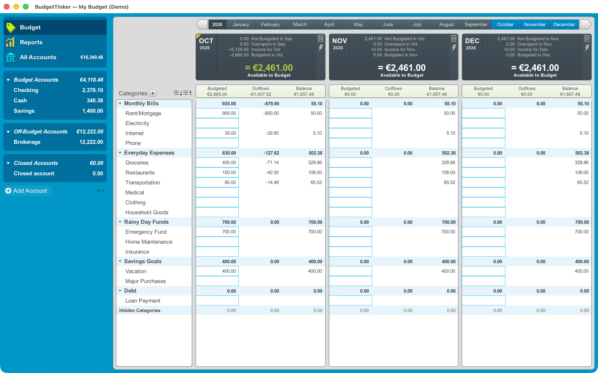

<p align="center"></p>
<h1 align="center">BudgetTinker</h1>
<p align="center">Local-first envelope budgeting for the desktop, built with Rust, egui and SQLite.</p>

BudgetTinker helps assign money to categories, track transactions and understand spending.
It runs as a native application without a browser or web server. This is an early project;
keep independent backups and review imported data before applying it.

## Application



The screenshot is captured from the real macOS app using synthetic data. The existing
classic light interface is preserved; a dark theme is not currently provided.

## Features

- Envelope categories, monthly allocations, rollover and current/next-month income.
- Budget and off-budget accounts, split transactions, paired transfers and reconciliation.
- Scheduled transactions, payee rules, category search and keyboard entry.
- Atomic changes with Undo/Redo, saved versions and JSON backups.
- Spending, income/expense and net-worth reports; CSV exports and macOS PDF/print support.
- CSV, QIF and OFX/QFX statement import with preview, duplicate detection and matching.
- legacy desktop budget import with validation and preview; unsupported structures are rejected.
- Multiple currencies with fixed-point amounts and optional exchange-rate lookup.

## Platforms and setup

macOS ARM64 is the locally verified platform. Windows x86-64 and Linux x86-64 release
builds and packaging have passed manual GitHub Actions; full GUI/runtime testing on those
platforms has not been completed. Some desktop
operations still invoke macOS tools (`osascript`, `open`, the Swift PDF helper); successful
compilation on another OS does not establish full desktop feature support.
[Platform support](docs/PLATFORMS.md) lists the exact supported and unsupported operations.

Install stable Rust with edition 2024 support. SQLite is compiled from the bundled source.
On macOS install Apple command line tools (`xcode-select --install`); Swift is required
for the PDF helper; Python 3 is used to stage verified distribution notices. From the project directory:

```sh
cargo run --locked
```

On Windows install the Rust MSVC toolchain and Visual Studio C++ Build Tools, then run
`cargo run --locked` in PowerShell. On Ubuntu install native dependencies first:

```sh
sudo apt-get install build-essential pkg-config libx11-dev libxcursor-dev libxrandr-dev libxi-dev libxkbcommon-dev libwayland-dev libgl1-mesa-dev libdbus-1-dev
cargo run --locked
```

Build the macOS app:

```sh
bash scripts/bundle.sh
codesign --verify --deep --strict dist/BudgetTinker.app
plutil -lint dist/BudgetTinker.app/Contents/Info.plist
```

This creates a locally ad-hoc signed app; it is not Apple-notarized. Every push to
`master` (including merged pull requests) automatically runs validation and all three
desktop builds. For other branches use **Actions → Run workflow** to choose a branch and
select all platforms or macOS, Linux or Windows; validation always runs. Downloadable
distribution archives are named `BudgetTinker-<version>-<platform>.<extension>`:
`BudgetTinker-0.1.0-alpha.2-macos-arm64.zip`,
`BudgetTinker-0.1.0-alpha.2-windows-x64.zip` and
`BudgetTinker-0.1.0-alpha.2-linux-x64.tar.gz`. GitHub Actions artifacts use the
corresponding name without an extension; GitHub wraps artifact downloads in a ZIP.
The app bundle and executable names inside archives remain unchanged.

### Publishing a GitHub Release

Cargo.toml is the source of truth for the version. After completing a batch of changes,
update Cargo.toml and Cargo.lock together using:

```sh
python3 scripts/bump-version.py 0.1.0-alpha.3
```

Commit and merge the version change into `master`. Wait for the automatically
triggered CI to pass, then from an up-to-date local `master` branch run:

```sh
git pull --ff-only origin master
git tag v0.1.0-alpha.3
git push origin v0.1.0-alpha.3
```

Pushing the tag triggers another full check and build for macOS ARM64, Windows x64,
and Linux x64. When all jobs pass, GitHub publishes a release titled
`BudgetTinker v0.1.0-alpha.3` with generated changelog and the three
versioned archives. Tags must match the package version and point to a commit in `master`;
mismatches fail CI without publishing a release. Versions containing a prerelease
suffix (e.g. `-alpha.3`) are marked as pre-releases. Ordinary commits to
`master` do not publish releases. The tag is not created automatically.

The private repository is [perevozchiko/budget-tinker](https://github.com/perevozchiko/budget-tinker),
with `master` as its primary branch and an initial source commit. The project is not yet
publicly released, and no GitHub Releases have been published.

To prepare a **local source review ZIP**, including the hidden workflow and ignore files:

```sh
python3 scripts/package-source.py
```

The script writes `dist/BudgetTinker-source.zip`, verifies every entry and includes
`.github/workflows/rust.yml` and `.gitignore` explicitly. It excludes builds, caches,
budgets and macOS metadata. The archive includes the project license texts and all third-party notices.
Creating the ZIP does not publish it.

## Local data and backups

New native budgets use **`.budgettinker`**, containing the existing SQLite schema.
Autosave writes to the opened file; JSON backup/export and CSV/QIF exports keep their
standard extensions. Older SQLite budgets can be selected through Open Budget without
renaming. Legacy budget folders and full snapshots remain import sources, separate from BudgetTinker's save format.

Default budget paths:

| Platform | Default file |
| --- | --- |
| macOS | `~/Library/Application Support/BudgetTinker/budget.budgettinker` |
| Windows | `%LOCALAPPDATA%/BudgetTinker/budget.budgettinker` (fallback `%APPDATA%`, then `%USERPROFILE%`) |
| Linux | `$XDG_DATA_HOME/budgettinker/budget.budgettinker` (fallback `~/.local/share/`) |

`BUDGETTINKER_DATA` overrides the default. Preferences beside the database
(`.preferences.json`) may select a recent budget. Existing installations' data is never
moved or deleted automatically. Open an old budget explicitly; make a backup first.
Budgets are not encrypted. Cloud/mobile sync and bank connections are not implemented.
Optional rate lookup contacts Frankfurter with currencies/date, not transaction contents.

For an isolated demo on macOS/Linux:

```sh
export BUDGETTINKER_DATA="$(mktemp -d /tmp/budgettinker-demo.XXXXXX)/demo.budgettinker"
cargo run --locked --example demo
cargo run --locked
```

Fixture generators can overwrite their destination; always choose a new temporary directory.
Do not copy a live SQLite file while WAL writes are active; use an application backup
or SQLite's backup API.

## Development and status

```sh
cargo fmt --all --check
cargo test --locked --quiet
cargo clippy --all-targets --locked -- -D warnings
cargo check --examples --locked
```

Windows/Linux builds and runtime support remain unverified; see the release audit.
The owner approved a narrowly scoped `ttf-parser`
maintenance exception through review on **2027-01-28**; all other advisories remain blocking.
See the dependency audit for the exact scope and enforcement.
See [Contributing](CONTRIBUTING.md), [Security](SECURITY.md), the
[development plan](docs/DEVELOPMENT-PLAN.md), [validation](docs/VALIDATION.md) and
[release audit](docs/PUBLIC-RELEASE-AUDIT.md) and [dependency audit](docs/DEPENDENCY-AUDIT.md). Known limits include explicit Uncategorized
handling for imported positive bank rows and unsupported legacy import structures.

## Licensing and attribution

BudgetTinker is licensed under **MIT OR Apache-2.0**, at your option.
See [MIT](LICENSE-MIT), [Apache-2.0](LICENSE-APACHE) and [license scope](LICENSE-STATUS.md).
Third-party components retain their own licenses. Package publishing is disabled as an
operational safeguard; the license grant is active.
[Attribution](ATTRIBUTION.md) records supplied branding, synthetic fixtures and dependency
assets. BudgetTinker is an independent project.
